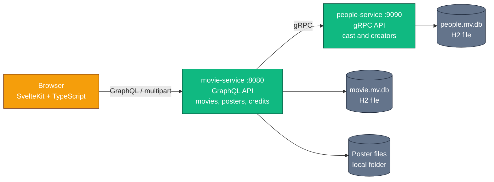
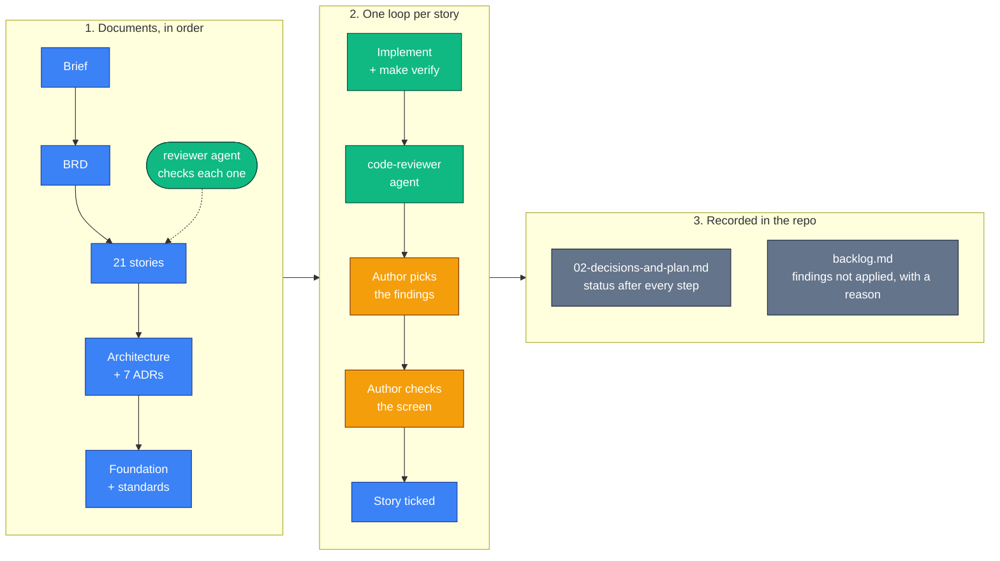

# Movie Hub

A small movie catalogue built for a technical assessment: list, add, edit and delete movies and the people who made them, upload poster artwork with real upload progress, link cast and creators to movies with a role, and search across both.

- Frontend: SvelteKit + TypeScript, talking GraphQL to the backend
- Backend: two Kotlin Spring Boot services, talking gRPC to each other
- Data: one H2 file database per service with Liquibase migrations, posters as files on disk
- Docker is optional: a JDK and Node are enough, or Docker Desktop can run the whole stack



Status: all 21 stories done, 50 verifier checks green, 225 backend and 191 frontend tests.

## Prerequisites

For the normal local workflow:

- JDK 21
- Node 26 (24 also works); npm comes with it

The Gradle wrapper downloads itself. Alternatively, install Docker Desktop with Docker Compose and use the Docker commands below; JDK and Node are then not required on the host.

## Run

```
make install   # once: frontend dependencies
make up        # people-service (gRPC :9090, health :8081), movie-service (:8080), frontend (:5173)
make down      # stop everything
```

The first start creates the databases under `backend/data/` and seeds ten movies with posters, twenty people and their credits. Each service also writes its log there, `backend/data/logs/<service>.log`, one JSON line per event, the same lines you see on the console. `make reset` deletes that folder so the next start seeds again.

Without make: `cd backend && ./gradlew :people-service:bootRun`, `./gradlew :movie-service:bootRun`, `cd frontend && npm run dev`.

### Docker alternative

```text
make docker-up       # build and start all three containers in the background
make docker-verify   # rebuild, verify cross-service calls and persistence, then stop containers
make docker-logs     # follow logs while the stack is running
make docker-down     # stop containers but preserve databases and uploaded posters
make docker-reset    # stop containers and delete their databases and uploaded posters
```

The Docker stack uses the same URLs as the normal workflow. Its two named volumes are separate from `backend/data/`: `docker-down` preserves them, while `docker-reset` deletes them so the next start loads the sample catalogue again. Do not run `make up` and `make docker-up` together because they use the same ports.

| What                                              | URL                                                                             |
| ------------------------------------------------- | ------------------------------------------------------------------------------- |
| The app                                           | http://localhost:5173                                                           |
| GraphiQL, the whole API in the browser            | http://localhost:8080/graphiql                                                  |
| Swagger UI, the one REST endpoint (poster upload) | http://localhost:8080/swagger-ui.html                                           |
| Health                                            | http://localhost:8080/actuator/health and http://localhost:8081/actuator/health |

## Test and verify

```
make test      # every backend (JUnit 6 + MockK) and frontend (Vitest + Testing Library) test
make verify    # build, all tests, then starts both services and the dev server and runs 50 live
               # smoke checks (health, GraphQL, gRPC, request id across both logs, one line per story)
```

`make verify` ends with `VERIFY: ALL PASSED` or the first failure and its log. It was run after every story. Two more checks need Google Chrome and a running app: `node scripts/check-responsive.mjs <movieId> <personId>` opens every page at phone, tablet and desktop width and reports sideways scroll, unlabelled fields, images without alt text and nameless buttons; `node scripts/screenshot.mjs <url> <width> <height> <out.png>` takes a screenshot at an emulated width.

## Where to look

Start at `docs/00-start-here/README.md`. The documents were written in this order and each one builds on the previous:

| Folder                  | What it holds                                                                                                                          |
| ----------------------- | -------------------------------------------------------------------------------------------------------------------------------------- |
| `docs/00-start-here/`   | the brief, the plan with its status, the repo layout and naming rules, the demo script                                                 |
| `docs/01-business/`     | one-page business requirements                                                                                                         |
| `docs/02-requirements/` | six epics, 21 stories with acceptance criteria, all ticked                                                                             |
| `docs/03-architecture/` | system design, technical architecture with versions, application architecture (data model, contracts, patterns), UI design, seven ADRs |
| `docs/04-engineering/`  | coding standards, testing strategy, definition of done, foundation checklist, backlog of deferred findings with reasons                |
| `docs/05-ai/`           | a one-page map of which skill or agent runs at each step, what it reads and what it produces                                           |

Code: `backend/` is a Gradle multi-project with `contracts` (the proto and generated stubs), `common` (error hierarchy, request id), `movie-service` and `people-service`. `frontend/` is the SvelteKit app. Each of those folders has a short README of its own. `scripts/` holds the verifier and the two Chrome scripts, `compose.yaml` and the two Dockerfiles the optional Docker stack, `.claude/` the agents and skills. Every file is meant to be explainable line by line; comments say why, not what.

## How AI tools were used

Claude Code was a productivity aid inside a fixed process, never a replacement for understanding the code. Green is AI, orange is the author, blue is a document, grey is a record.



The tooling is small and in the repo: a root `CLAUDE.md`, two agents and six skills under `.claude/`, all plain Markdown. 

What stayed out on purpose: a search engine, a message broker, authentication, downloaded posters (copyright), and any library the brief did not need. The reasons are in the ADRs and the backlog.
