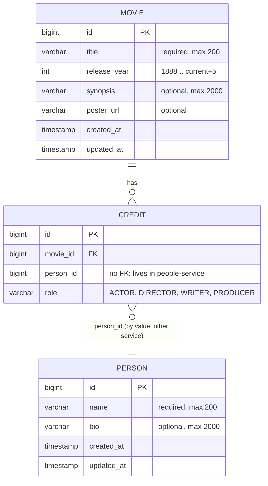
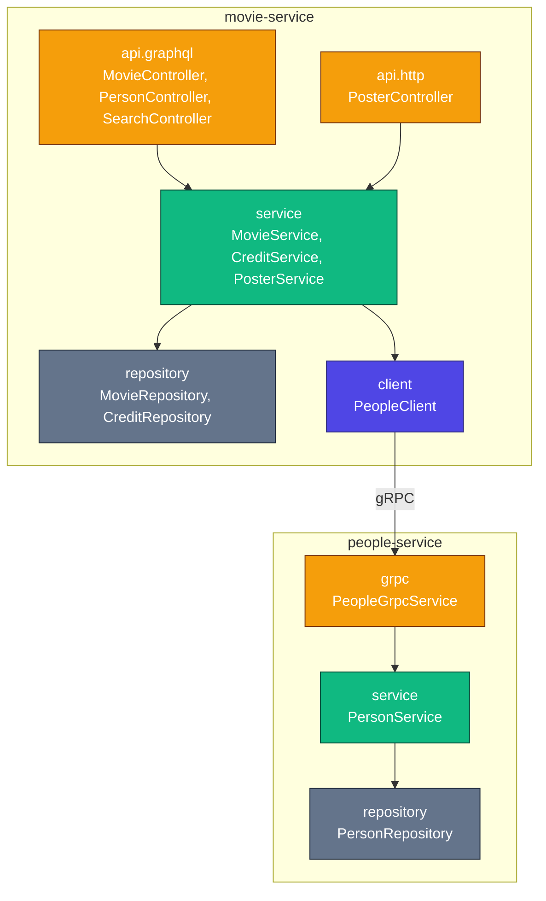

# Application Architecture - Movie Hub

| | |
|---|---|
| Version | 0.1 |
| Status | Reviewed, draft accepted |
| Date | 2026-10-09 |
| Inputs | `system-design.md`, `technical-architecture.md`, `docs/02-requirements/epics-and-stories.md` |

Application architecture answers: what is the data, how is code organised inside each piece, and which patterns does every story reuse. The foundation phase builds exactly what this document says; the `implement-story` skill points here.

## 1. Data model



| Table | Owner | Rules |
|-------|-------|-------|
| `movie` | movie-service | Title and year required. Deleting a movie deletes its credits and poster file |
| `credit` | movie-service | Unique on (movie_id, person_id, role). `person_id` is a value copied from people-service; there is no cross-database foreign key. Deleting a person deletes their credits first, then the person (see system design 3.3) |
| `person` | people-service | Name required |

Cast = credits with role ACTOR. Creators = all other roles. IDs are database-generated longs; because the two databases are separate, a person ID is meaningful only inside people-service and is treated as an opaque value elsewhere.

## 2. Contracts

### GraphQL (movie-service, `schema.graphqls`)

```graphql
type Movie   { id: ID!, title: String!, releaseYear: Int!, synopsis: String, posterUrl: String, credits: [Credit!]! }
type Person  { id: ID!, name: String!, bio: String, credits: [PersonCredit!]! }
type Credit  { id: ID!, role: Role!, person: Person! }
type PersonCredit { id: ID!, role: Role!, movie: Movie! }
enum Role    { ACTOR DIRECTOR WRITER PRODUCER }
enum MovieSort { TITLE_ASC TITLE_DESC YEAR_ASC YEAR_DESC }
input MovieInput  { title: String!, releaseYear: Int!, synopsis: String }
input PersonInput { name: String!, bio: String }
type MoviePage { items: [Movie!]!, page: Int!, size: Int!, total: Int! }
type SearchResult { movies: [Movie!]!, people: [Person!]! }

type Query {
  movies(page: Int = 0, size: Int = 12, sort: MovieSort = TITLE_ASC): MoviePage!
  movie(id: ID!): Movie
  people: [Person!]!
  person(id: ID!): Person
  search(text: String!): SearchResult!
}
type Mutation {
  createMovie(input: MovieInput!): Movie!      updateMovie(id: ID!, input: MovieInput!): Movie!   deleteMovie(id: ID!): Boolean!
  createPerson(input: PersonInput!): Person!   updatePerson(id: ID!, input: PersonInput!): Person! deletePerson(id: ID!): Boolean!
  addCredit(movieId: ID!, personId: ID!, role: Role!): Credit!   removeCredit(id: ID!): Boolean!
}
```

Poster upload is not in the schema: `POST /movies/{id}/poster` (multipart) returns `{ "posterUrl": "/posters/42.jpg?v=1760194800000" }`. The file keeps its name on replace, so the URL carries a version; browsers then fetch the new picture instead of their cached copy (E3-S3).

### gRPC (`backend/contracts`, `moviehub/people/v1/people.proto`)

```
service PeopleService {
  rpc GetPerson    (GetPersonRequest)    returns (Person);
  rpc GetPeople    (GetPeopleRequest)    returns (PeopleList);     // batch by ids, used by movie credits
  rpc ListPeople   (ListPeopleRequest)   returns (PeopleList);
  rpc SearchPeople (SearchPeopleRequest) returns (PeopleList);
  rpc CreatePerson (CreatePersonRequest) returns (Person);
  rpc UpdatePerson (UpdatePersonRequest) returns (Person);
  rpc DeletePerson (DeletePersonRequest) returns (google.protobuf.Empty);
}
```

Every people operation from the UI goes GraphQL -> movie-service -> gRPC -> people-service. This keeps one API for the frontend and makes gRPC the only way into people-service.

## 3. Code layout and layers

Both services use the same four layers so a reader learns the shape once.



| Layer | Package | Contains | Rule |
|-------|---------|----------|------|
| API | `api.graphql`, `api.http`, `grpc` | Spring for GraphQL `@Controller`s, the poster `@RestController`, the gRPC service implementation | Maps transport to service calls. No business logic |
| Service | `service` | One class per aggregate: `MovieService`, `CreditService`, `PosterService` in movie-service; `PersonService` in people-service. Services call `PeopleClient` for people data | All rules and validation live here. Throws `AppException` subtypes |
| Repository | `repository` | Spring Data JPA interfaces | Queries only. Search is `findByTitleContainingIgnoreCase` |
| Domain | `domain` | JPA entities and enums | Plain data; no behaviour beyond invariants |
| Client | `client` | Generated gRPC stub wrapped in `PeopleClient` | The only class that knows gRPC types; maps `StatusRuntimeException` to `AppException` |
| Config | `config` | `PostersProperties`, `GrpcClientConfig`, `CorsConfig` | `@ConfigurationProperties`, no logic |
| Shared | `backend/common` module | `AppException`, `ErrorCode`, request-ID filter and gRPC interceptors | Used by both services so nothing is duplicated. No business logic |

Full file tree is in `docs/00-start-here/03-repo-layout.md`; the names there match this document.

## 4. Cross-cutting patterns (built once in Phase 1)

### 4.1 Errors: one hierarchy, one code per boundary

```kotlin
sealed class AppException(val code: ErrorCode, message: String) : RuntimeException(message)
class NotFoundException(what: String, id: Any)  : AppException(ErrorCode.NOT_FOUND, "$what $id not found")
class ValidationException(message: String)       : AppException(ErrorCode.VALIDATION, message)
class ConflictException(message: String)         : AppException(ErrorCode.CONFLICT, message)
class DependencyUnavailableException(dep: String): AppException(ErrorCode.UNAVAILABLE, "$dep is unavailable")
enum class ErrorCode { NOT_FOUND, VALIDATION, CONFLICT, UNAVAILABLE, INTERNAL }  // INTERNAL is set only by the edge mappers for unexpected exceptions
```

| Boundary | Mapper | Result |
|----------|--------|--------|
| Service -> GraphQL | `GraphQlExceptionResolver` (a `DataFetcherExceptionResolverAdapter`) | GraphQL error with `extensions.code` = ErrorCode and a user-safe message |
| Service -> REST (poster) | `@RestControllerAdvice` | RFC 9457 `ProblemDetail` with `code` property; 404, 400, 409, 503 |
| Service -> gRPC server (people-service) | `@GrpcAdvice` handler | `Status.NOT_FOUND`, `INVALID_ARGUMENT`, `ALREADY_EXISTS`, `INTERNAL` |
| gRPC client -> service (movie-service) | `PeopleClient` | Reverse of the above; `UNAVAILABLE` becomes `DependencyUnavailableException` |
| Frontend | `ApiError { code, message }` thrown by `lib/api/client.ts` | Pages map `code` to UI: NOT_FOUND page, VALIDATION under the field, others as an error toast with Retry |

Unexpected exceptions are logged with a stack trace and surfaced as a generic `INTERNAL` error; the message never leaks internals.

### 4.2 Validation: twice, server is the truth

- Backend: Jakarta Bean Validation on GraphQL input classes (`@NotBlank`, `@Size`, `@Min(1888)`, and a small custom `@MaxYearsAhead(5)` for the upper bound), triggered by `@Valid` on controller arguments, plus rules that need data (uniqueness of a credit, existence of a person) in the service as `ConflictException` or `NotFoundException`. people-service re-checks the simple rules (blank, length) in its service too, because gRPC is a public door into it that bypasses the GraphQL edge; it throws `ValidationException`, which movie-service maps back to the same VALIDATION code.
- Frontend: the same simple rules in the form for instant feedback (required, length, year range, file type and size). Server errors with code VALIDATION are still shown under the form.

### 4.3 Logging: structured, one request ID across both services

- Spring Boot structured logging to the console (`logging.structured.format.console=ecs`), one JSON line per event.
- A servlet filter in movie-service reads or creates `X-Request-Id`, puts it in MDC, and returns it in the response.
- A gRPC client interceptor forwards the ID as metadata `x-request-id`; a server interceptor in people-service puts it in MDC.
- One log line per GraphQL operation, poster upload and gRPC call: operation name, duration, outcome. Errors log the `ErrorCode`; unexpected ones log the stack.

### 4.4 API discovery

- Actuator health on both services (`/actuator/health`).
- GraphiQL at `/graphiql` in the local profile for exploring the GraphQL schema.
- Swagger UI via springdoc for the REST upload endpoint and actuator, if a Spring Boot 4 compatible springdoc version exists at scaffold time; otherwise the endpoint is documented in the README.

### 4.5 Configuration

| Property | Default (local) | Test |
|----------|-----------------|------|
| `spring.datasource.url` | `jdbc:h2:file:../data/<service>;MODE=PostgreSQL` (relative to the module dir, so the file lands in `backend/data/`) | `jdbc:h2:mem:test;MODE=PostgreSQL` |
| `spring.liquibase.change-log` | `classpath:db/changelog/db.changelog-master.xml` | same |
| `moviehub.posters.dir` | `../data/posters` (same rule: `backend/data/posters/`) | temp dir |
| `moviehub.posters.max-size` | `10MB` | `10MB` |
| `spring.grpc.client.channel.people.target` | `localhost:9090` | same (the stub is mocked in tests) |

Profiles: `local` (default) and `test`. Everything above is in `application.yml` with a `test` override; no secrets exist. `bootRun` runs with the module directory as working directory, which is why the data paths start with `../`.

### 4.6 Seed data (E6-S2)

Sample data is a Liquibase changeset in each service (`changes/0099-E6-S2-seed.xml`) with explicit IDs from 100001 so credits can reference people across the two databases and never collide with generated ids. It is tagged with context `seed`, enabled in the `local` profile only (`spring.liquibase.contexts: schema,seed`; the base config lists `schema` alone so the seed stays off elsewhere), and guarded by a precondition that marks it ran when the table already has rows. Posters for the seed are ten small SVGs in `movie-service/src/main/resources/seed-posters/`, served under `/posters/` next to uploaded files; uploading a real poster replaces them like any other. The two seeds are guarded independently, so they only line up when both databases start empty together; `make reset` deletes the whole of `backend/data/` for that reason, and deleting one file by hand is not supported.

## 5. Frontend structure and patterns

```
src/lib/
├── api/        client.ts (GraphQL fetch + ApiError), movies.ts, people.ts, credits.ts, search.ts, upload.ts (XHR with progress)
├── components/ MovieCard, PersonCard, SearchBox, UploadProgress, Toast, ConfirmDialog, EmptyState, ErrorState, Spinner, Pagination
├── stores/     toast.ts
└── types/      graphql.ts (hand-written types matching the schema)
src/routes/     +layout.svelte (header, nav, search box from E5-S1, footer, toast outlet), +page (movie grid), movies/new, movies/[id], movies/[id]/edit, people, people/new, people/[id], people/[id]/edit, search. Screens are drawn in `ui-design.md`
```

| Pattern | How |
|---------|-----|
| Loading, empty, error on every list and detail page | A page holds `status: 'loading' | 'ready' | 'empty' | 'error'` in `$state`; the template renders `Spinner`, content, `EmptyState` or `ErrorState` with Retry. Same shape on every page |
| Saving feedback on every form | Submit button disabled with a spinner while the mutation runs; success toast and navigate; VALIDATION errors shown under the form |
| Confirm before delete | `ConfirmDialog` component; the mutation runs only on confirm |
| Upload progress | `upload.ts` uses `XMLHttpRequest` and reports `progress` events; `UploadProgress` shows the percentage; failure keeps the previous poster |
| Responsive grid | CSS grid with `auto-fill, minmax(160px, 1fr)`; one column at 375 px, four or more on desktop |
| Accessibility (N5) | Every input has a `<label>`, buttons are real `<button>`s, posters have `alt` text, dialog traps focus |

## 6. Where tests sit

See `technical-architecture.md` section 4. Rule of thumb: service classes are tested with MockK and no Spring; controllers with `@GraphQlTest`; repositories with `@DataJpaTest`; the people gRPC service as unit tests with a mocked `StreamObserver`; frontend components with Testing Library and a mocked `client.ts`.

## 7. Decisions recorded

| ADR | Decision |
|-----|----------|
| 0006 | Java blocking gRPC stubs called from Kotlin; no grpc-kotlin (decision 9) |
| 0007 | One error hierarchy with a code per boundary; RFC 9457 for REST (decision 10) |

This document is allowed to exceed the two-page default because the foundation is built directly from it.
