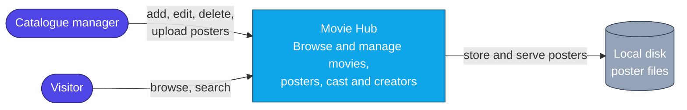
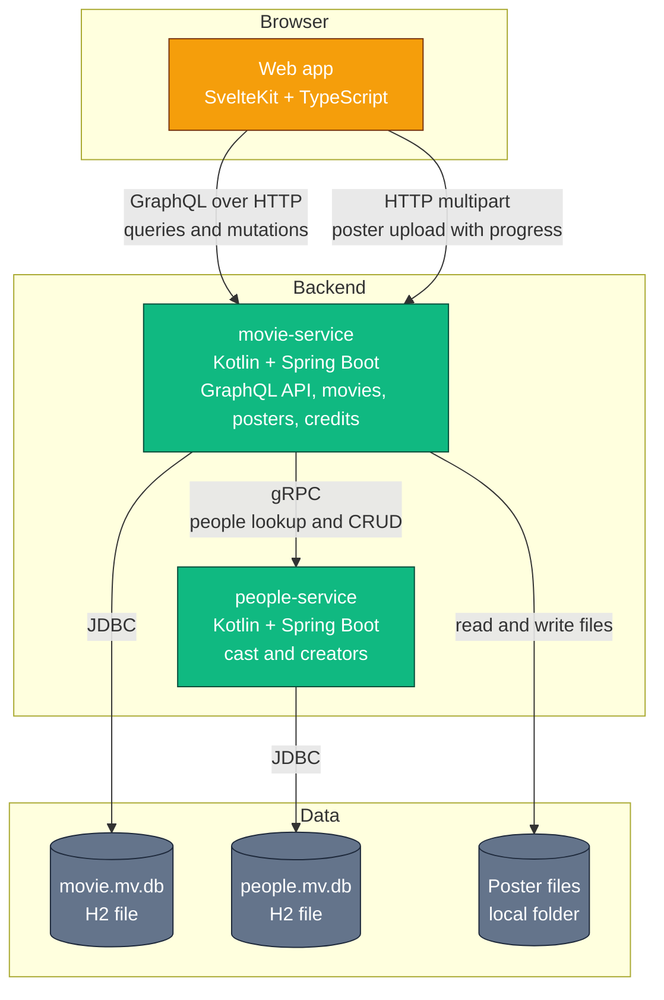
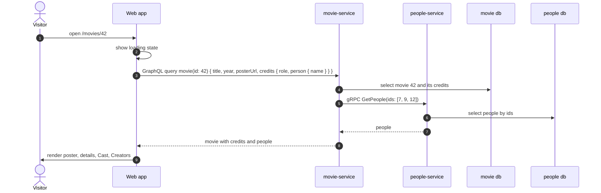
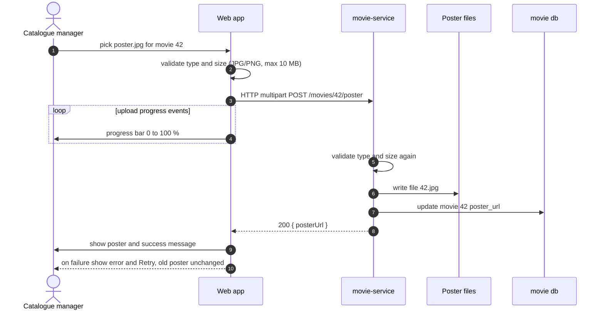

# System Design - Movie Hub

| | |
|---|---|
| Version | 0.1 |
| Status | Reviewed, draft accepted |
| Date | 2026-10-09 |
| Inputs | `docs/01-business/brd.md`, `docs/02-requirements/epics-and-stories.md` |

System design answers one question: what are the big pieces and how do they talk? Details of technology and code structure live in the technical and application architecture documents.

## 1. Context - who uses the system and what it depends on

Two personas, one system, no external services. Posters are files on local disk, kept outside the database.

## 2. Containers - the deployable pieces

| Container | Owns | Talks to |
|-----------|------|----------|
| Web app | Screens, forms, search box, upload progress, all user feedback | movie-service only |
| movie-service | Movies, posters, credits (movie + person + role). Hosts the single GraphQL API for the frontend | people-service over gRPC, its own H2 file, poster files |
| people-service | People (cast and creators): create, read, update, delete, search | Its own H2 file |
| H2 files | One file database per service. A service never opens the other's file | - |
| Poster files | JPG or PNG files named by movie ID, served as static URLs | - |

Why one GraphQL entry point: the frontend needs one place to ask for a movie with its people. movie-service already owns the credits that link the two, so it is the natural host. people-service stays a pure domain service with a gRPC interface only. See ADR 0002.

## 3. Key flows

### 3.1 Open a movie page (read across both services)

### 3.2 Upload a poster (write with progress)

### 3.3 Delete a person (write across both services)

Deleting a person must also remove their credits, which live in movie-service. The GraphQL mutation in movie-service deletes the credits in its own database first, then calls people-service over gRPC to delete the person. If the gRPC call fails the mutation returns an error and the credits deletion is rolled back.

## 4. Decisions this design depends on

| ADR | Decision |
|-----|----------|
| 0001 | Two services split by domain: movies and people |
| 0002 | GraphQL hosted in movie-service, people-service exposes gRPC only |
| 0003 | Poster upload over plain HTTP multipart, files on local disk |
| 0004 | H2 file database per service, Liquibase migrations in XML; PostgreSQL as the upgrade path |
| 0006 | Java blocking gRPC stubs called from Kotlin |
| 0007 | One error hierarchy with one error code per boundary |
| 0005 | Search is a database query, no search engine |

## 5. Out of scope for this design

Authentication, multiple instances of a service, message queues, caching layers, cloud storage, a server database. All are possible later without changing the container boundaries.
