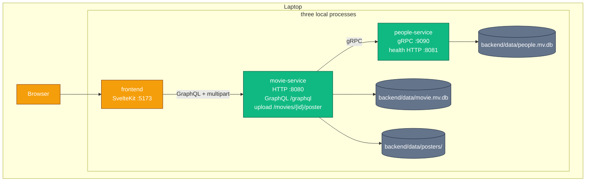

# Technical Architecture - Movie Hub

|         |                                               |
| ------- | --------------------------------------------- |
| Version | 0.1                                           |
| Status  | Reviewed, draft accepted                      |
| Inputs  | `system-design.md`, the brief, ADRs 0001-0005 |

Technical architecture answers: which technologies, which versions, how they are wired, and how the whole thing runs on a laptop. Code structure inside each piece is in `application-architecture.md`.

## 1. Stack and versions

Versions were looked up (sources at the end). Rule: prefer the current stable line that the Spring Boot BOM or the official scaffolder gives us, not the newest number. Where Spring Boot manages a version, we do not pin it ourselves.

| Layer            | Technology                                 | Version                | Who pins it                      | Note                                                                                                                                     |
| ---------------- | ------------------------------------------ | ---------------------- | -------------------------------- | ---------------------------------------------------------------------------------------------------------------------------------------- |
| Runtime          | Java                                       | 21 (LTS)               | Gradle toolchain                 | Spring Boot 4 needs 17+. 21 has the widest tool support; 25 LTS is possible later                                                        |
| Language         | Kotlin                                     | 2.3.x                  | Gradle plugin, aligned with Boot | Boot 4.1 baseline is Kotlin 2.3. 2.4.20 exists but is not yet Boot-managed; verify in the spike                                          |
| Backend          | Spring Boot                                | 4.1.1                  | Gradle plugin                    | Current line; brings gRPC auto-configuration into Boot itself                                                                            |
| API              | Spring for GraphQL                         | 2.0.x                  | Boot BOM                         | Schema-first, `@Controller` resolvers                                                                                                    |
| RPC              | gRPC Java                                  | 1.80.x                 | Boot BOM                         | Spring Boot 4.1 gRPC server and client starters. Java blocking stubs called from Kotlin; grpc-kotlin coroutine stubs not used (ADR 0006) |
| RPC              | Protobuf                                   | 4.x                    | Boot BOM                         | `protobuf-java`; protoc matched to it                                                                                                    |
| API docs         | springdoc-openapi                          | 3.1.1                  | Version catalog                  | Swagger UI for the REST upload endpoint; GraphQL is explored through GraphiQL                                                            |
| Build            | Gradle                                     | 9.8.1                  | Wrapper                          | Kotlin DSL, version catalog `backend/gradle/libs.versions.toml`. Wrapper generated once from a cached Gradle 9.4.1                       |
| Build            | protobuf Gradle plugin                     | 0.10.0                 | Version catalog                  | Generates Java stubs in `backend/contracts`                                                                                              |
| Database         | H2 (file mode, PostgreSQL compatibility)   | managed                | Boot BOM                         | One file per service under `backend/data/`. PostgreSQL 18 is the documented upgrade path                                                 |
| Migrations       | Liquibase                                  | managed                | Boot BOM                         | XML master changelog per service, one changeset file per story                                                                           |
| Backend tests    | JUnit Jupiter                              | 6.x                    | Boot BOM                         | Boot 4.1 moved to JUnit 6                                                                                                                |
| Backend tests    | MockK                                      | 1.14.11                | Version catalog                  | Kotlin-native mocking                                                                                                                    |
| Backend tests    | H2                                         | managed                | Boot BOM                         | In-memory for tests, same engine as runtime                                                                                              |
| Frontend runtime | Node.js                                    | 26                     | `.nvmrc`, `engines`              | Installed on the author's machine; becomes Active LTS on 2026-10-28. 24 LTS also works                                                   |
| Package manager  | npm                                        | 11.x (ships with Node) | `package-lock.json`              | No extra install for reviewers; pnpm would add a prerequisite for no gain at this size                                                   |
| Frontend         | SvelteKit                                  | 3.0.x                  | package.json                     | Released 2026-10-01; what `sv create` scaffolds today. Fallback to 2.x if the spike finds tooling gaps                                   |
| Frontend         | Svelte                                     | 5.57.x                 | package.json                     | Runes mode                                                                                                                               |
| Frontend         | TypeScript                                 | 6.0.x                  | package.json                     | Strict mode; what `sv create` pins today                                                                                                 |
| Frontend         | Vite                                       | 8.x                    | package.json                     | Build tool and dev server; also hosts the Vitest config                                                                                  |
| GraphQL client   | plain `fetch` in `lib/api/client.ts`       | -                      | -                                | About 30 lines, no dependency, easy to explain and to mock. Replaced the earlier graphql-request choice at scaffold time                 |
| Frontend tests   | Vitest                                     | 4.1.x                  | package.json                     | The version `sv create` pins; 5.0 exists but the scaffolder has not moved yet                                                            |
| Frontend tests   | @testing-library/svelte + jest-dom + jsdom | 5.4.x / 7.0.x / 30.x   | package.json                     | Component tests in jsdom; files named `X.svelte.test.ts`                                                                                 |
| Local run        | Make                                       | -                      | -                                | One command: `make up`. Docker is not required                                                                                           |

## 2. How the pieces are wired



| Path                            | Protocol                                  | Contract lives in                                                  | Notes                                                                                                               |
| ------------------------------- | ----------------------------------------- | ------------------------------------------------------------------ | ------------------------------------------------------------------------------------------------------------------- |
| Browser to movie-service        | GraphQL over HTTP POST `/graphql`         | `movie-service/src/main/resources/graphql/schema.graphqls`         | Queries: movies, movie, people, person, search. Mutations: create/update/delete movie and person; add/remove credit |
| Browser to movie-service        | HTTP multipart POST `/movies/{id}/poster` | Plain Spring `@RestController`                                     | Browser uses XMLHttpRequest for progress events. Returns `{ posterUrl }`                                            |
| Browser to movie-service        | HTTP GET `/posters/{file}`                | Static resource handler                                            | Serves files from the posters folder                                                                                |
| movie-service to people-service | gRPC                                      | `backend/contracts/src/main/proto/moviehub/people/v1/people.proto` | `PeopleService`: GetPerson, GetPeople, ListPeople, SearchPeople, CreatePerson, UpdatePerson, DeletePerson           |
| Services to H2                  | JDBC via Spring Data JPA                  | Liquibase changelog per service                                    | Each service opens only its own file                                                                                |

Errors cross boundaries in one shape each way: gRPC `Status` codes (NOT_FOUND, INVALID_ARGUMENT, ALREADY_EXISTS) are mapped in movie-service to GraphQL errors with a `code` extension, and the frontend maps `code` to a user message. Details in `application-architecture.md`.

## 3. Local run

```
make up      # starts people-service, movie-service (Gradle bootRun) and the frontend (npm run dev)
make test    # ./gradlew test in backend/ and npm test in frontend/
make down
```

Docker is not required. The default prerequisites are JDK 21 and Node 26 (or 24). H2 files and posters are created on first run under `backend/data/` (git-ignored); sample data (E6-S2) loads automatically on first start through a Liquibase seed changeset. Profiles: `local` (file databases, ports above), `test` (in-memory H2, temp poster dir). The optional local `compose.yaml` packages the same three processes and uses separate named volumes; it does not change the architecture or add a server database.

## 4. Testing tools

| Level      | Backend                                                                                                                                          | Frontend                                                                    |
| ---------- | ------------------------------------------------------------------------------------------------------------------------------------------------ | --------------------------------------------------------------------------- |
| Unit       | JUnit 6 + MockK: services, mappers, validators                                                                                                   | Vitest: api modules, stores, pure functions                                 |
| Component  | `@GraphQlTest` for resolvers, `@DataJpaTest` with in-memory H2 for repositories, gRPC service methods unit-tested with a mocked `StreamObserver` | Vitest + Testing Library: components and their loading, empty, error states |
| End to end | Manual demo script (Phase 3); no automated e2e in scope                                                                                          |                                                                             |

## 5. Version policy

- Backend versions live in `backend/gradle/libs.versions.toml`; the Spring Boot BOM owns everything it manages.
- Frontend versions live in `package.json` with exact pins; `package-lock.json` is committed.
- The spike (Phase 1) proves the combination Spring Boot 4.1.1 + Kotlin 2.3 + gRPC starters + protobuf plugin 0.10.0 compiles and runs before the real scaffold. Any change found there updates this table and ADR 0006.
- Upgrades are a deliberate task with a log row, never a side effect of a story.

## 6. Known risks

| Risk                                                                           | Mitigation                                                                                                                             |
| ------------------------------------------------------------------------------ | -------------------------------------------------------------------------------------------------------------------------------------- |
| SvelteKit 3 is eight days old; tutorials and AI training data mostly cover 2.x | Use the official `sv create` scaffold and official docs; fall back to SvelteKit 2.x if Testing Library or the GraphQL client misbehave |
| Spring Boot 4.1 gRPC auto-configuration is new                                 | Spike first; fallback is the community `grpc-ecosystem/grpc-spring` starter 3.1                                                        |
| Kotlin 2.4 not yet aligned with Boot 4.1                                       | Stay on the Boot-managed 2.3 line                                                                                                      |

Version sources with the lookup date are in `version-sources.md`.
