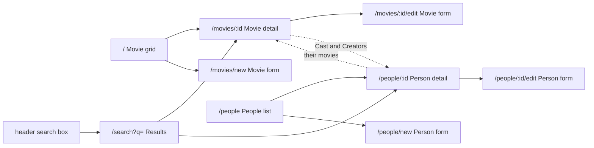

# UI Design - Movie Hub

| | |
|---|---|
| Version | 0.1 |
| Status | Reviewed, 12 of 13 findings applied |
| Date | 2026-10-11 |
| Inputs | The brief, `docs/01-business/brd.md` (N1, N2, N5), `docs/02-requirements/epics-and-stories.md`, reference images in `docs/00-start-here/brief/reference/` |

UI design answers: which screens exist, how they link, what each one shows, and how the layout and feedback rules apply to all of them. Code structure for the frontend is in `application-architecture.md` section 5.

## 1. How the screens were derived from the brief

| Brief says | Design decision |
|------------|-----------------|
| Two nouns: movies, cast and creators | Two sections in the nav, Movies and Cast & Creators (the route stays `/people`) |
| List, add, update, delete for each | One list page, one detail page and one form (shared by new and edit) per noun |
| "List movies **with artwork**" | The home page is a grid of poster cards, not a table; a placeholder stands in for a missing poster |
| "Upload movie artwork" | Upload lives on the movie detail page, next to the poster it replaces |
| "Search movies, cast and creators" | One search box in the header on every page; Enter opens the results page with two groups |
| Feedback for listing, updating, upload, searching | Every list page has loading, empty and error states; every form has saving, success and validation; delete confirms first; upload shows a percentage |
| "Responsive" | One centred column, a grid that fills as many columns as fit, forms and nav that wrap |
| "Explain every line" | System font, one dark header, one accent colour, no CSS framework |

## 2. App shell

Every page renders inside the same shell (`src/routes/+layout.svelte`):

```
┌──────────────────────────────────────────────────────┐
│ ▣ Movie Hub  Movies  Cast & Creators  [ search...  ] │  header: brand mark + nav + search box, current link highlighted
├──────────────────────────────────────────────────────┤
│ ← Back                                               │  detail and form pages only
│ Page title                               [+ Primary] │  page-header: title, one-line description, primary action
│ one-line description                                 │
│   page content, max width 72rem, 16px side gutter    │  main
├──────────────────────────────────────────────────────┤
│ Movie Hub  Your movie collection, cast and creators in one place. │  footer: brand + tagline
└──────────────────────────────────────────────────────┘
                                   ┌─────────────────┐
                                   │ toast (success/ │  bottom centre, auto-dismiss, aria-live
                                   │ error message)  │
                                   └─────────────────┘
```

## 3. Screen map



List pages, detail pages and forms; one form serves both new and edit. Dotted lines cross the two services: the movie page shows people from people-service, the person page shows movies from movie-service. The header box is built; it carries the text to `/search?q=`, and E5-S1 makes that page search.

## 4. Screens

Text wireframes at desktop width. On a phone the people list stacks into one column, the poster grid keeps two, and side-by-side sections stack.

**Movie grid `/`** (E2-S1, E2-S6, E6-S1)
```
Movies                        [Sort: Title ▾ (stretch, E6-S1)]  [+ Add movie]
┌──────┐ ┌──────┐ ┌──────┐ ┌──────┐
│poster│ │poster│ │ no   │ │poster│      MovieCard: poster (2:3), title, year
│      │ │      │ │poster│ │      │      card links to the detail page
│Title │ │Title │ │Title │ │Title │
│2019  │ │2021  │ │1999  │ │2024  │
└──────┘ └──────┘ └──────┘ └──────┘
                 ‹ 1 2 3 ›                pagination, 12 per page
```

**Movie detail `/movies/:id`** (E2-S2, E2-S5, E3-S1 to S3, E4-S1, E4-S2)
```
← Back to movies
┌────────┐  Title (2019)                          [Edit] [Delete]
│ poster │  Synopsis text...
│        │
│        │  Poster  [Choose file]  JPG or PNG, up to 10 MB
└────────┘           ████████░░ 80 %                 UploadProgress only while uploading;
                                                     wrong type or size: error on pick, nothing starts
Cast                                   Creators                              (built stacked, one under the other,
- Anna Example  Actor      [Remove]    - Chris Example  Director  [Remove]    so phone and desktop read the same)
- "None yet"
Add a credit   find person [nol__]  role ▾  [Add]        always visible, no toggle; "No people found" + link to /people/new
               "already credited" under the box
```

**Movie form `/movies/new`, `/movies/:id/edit`** (E2-S3, E2-S4)
```
← Back
Add movie / Edit movie
Title          [___________________]   validation message under the field
Release year   [____]
Synopsis       [___________________]
               [Cancel]  [Save]        Cancel first, Save last at the right edge (as the reference); Save disabled with spinner while saving
```

**People list `/people`** (E1-S1)
```
Cast & Creators                                    [+ Add person]
The people behind the movies...
┌─────────────────────┐ ┌─────────────────────┐
│ (A) Anna Example     │ │ (C) Chris Example    │   PersonCard: initial in a circle (no photos in scope), name, first line of bio
│ Actor known for...   │ │ Director of...       │   card links to the detail page
└─────────────────────┘ └─────────────────────┘
```

**Person detail `/people/:id`** (E4-S3, E1-S4) and **Person form** (E1-S2, E1-S3) follow the movie detail and movie form shapes: name and bio, Edit and Delete, then a "Movies" list with the role in each.

**Search results `/search?q=nolan`** (E5-S1)
```
Results for "nolan"                    SearchBox in the header keeps the text; a new search updates the page
Movies                                 People
┌──────┐ ┌──────┐                      - Christopher Nolan  Director
│poster│ │poster│                      "No people match"
└──────┘ └──────┘
```

## 5. Responsive rules (N1, E5-S2)

| Width | Rule |
|-------|------|
| Phone, about 375 px | People cards one column, poster cards two (as the reference mobile screen shows); nav wraps under the brand; detail page stacks poster above text; buttons full width |
| Tablet, about 768 px | Grid `auto-fill, minmax(160px, 1fr)` gives two to four cards; forms stay one column |
| Desktop, 1024 px and up | Content capped at 72rem and centred; four to six cards; detail page poster beside text |

Only CSS grid, flex-wrap and one media query at 640 px: below it buttons go full width and the detail page stacks the poster above the text; above it the poster sits beside the text. No breakpoint system, no CSS framework.

## 6. Feedback states per screen (N2)

| Screen | Loading | Empty | Error + Retry | Saving | Progress % | Confirm |
|--------|---------|-------|---------------|--------|------------|---------|
| Movie grid | Spinner | "No movies yet" | ErrorState | | | |
| Movie detail | Spinner | "None yet" per list; "Movie not found"; "No people found" in the credit picker | ErrorState; "already credited" under the picker; upload: type or size error on pick, Retry on failure with the old poster kept | add credit | poster upload | delete movie, remove credit |
| Movie form | | | toast | Save button | | |
| People list | Spinner | "No people yet" | ErrorState | | | |
| Person detail | Spinner | "No credits yet"; "Person not found" | ErrorState | | | delete person |
| Person form | | | toast | Save button | | |
| Search results | Spinner | "No results for '<text>'" | ErrorState | | | |

Success is always the toast from section 2, after every create, update, delete, upload and credit change (N2). All of these use the components already in `src/lib/components/`: `Spinner`, `EmptyState`, `ErrorState`, `Toast`, `ConfirmDialog`, plus `UploadProgress` (E3-S1) and `Pagination` (E2-S6) when their stories arrive.

## 7. Visual choices

| Choice | Value | Why |
|--------|-------|-----|
| Font and colours | `system-ui`; header `#0f172a`, text on `#f8fafc`, accent `#4f46e5`, danger `#dc2626`, as CSS variables in `src/app.css`. Two literals are allowed outside the variables: white text on a dark surface (`#fff`) and the translucent black of the dialog backdrop and toast shadow | Zero download; one dark, one light, one accent, one danger; nothing to explain |
| Buttons and forms | `.btn` primary, secondary, danger; `.field` label above input, error under it; all real `<button>`s | N5 keyboard and screen-reader access; one look for every form |
| Posters | 2:3 box, `object-fit: cover`, grey placeholder with the title as `alt` | Cards stay aligned with mixed image sizes |
| Icons | None, text labels only; the brand mark is a bordered box drawn in CSS | No icon library to justify |
| Cards | White surface, soft shadow, 0.75rem radius; people cards show the name's initial in a circle | The look of the reference without its photos |

## 8. Checked against reference images

Five images in `docs/00-start-here/brief/reference/` (a poster wall, a grid example, an admin form example, a cast poster and a nine-screen concept) were compared with this doc after it was written. Adopted or confirmed: 2:3 poster cards, "+ Add" top right of each list, Edit and Delete on detail pages, Save and Cancel pairs, the file hint next to Choose file, a one-line footer (built in the frontend foundation), the search box in the header, Back links. Left out on purpose: genre, runtime, ratings, profile images, a role on the person (ours is on the credit, so one person can act in one movie and direct another), upload on the create form (a movie has no ID until saved), tabs for Cast and Creators, a footer with quick links and social icons, a user avatar. None of these are in the brief.

Visual pass (E5-S3, 2026-10-12): the built screens were compared with these wireframes. Two deliberate differences stay: Cast and Creators, and the Movies and People search groups, are stacked instead of side by side, because stacked lists read the same on a phone and a desktop; the poster upload sits under the poster it replaces rather than beside the title. The wireframes above were amended to what is built where they had simply drifted (Cancel before Save, the always-visible credit box, the toast position).
