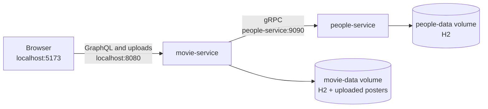

# Local Docker Plan

> **Status:** implemented and runtime-verified on 2026-10-12. `make docker-verify` passes on native Apple Silicon images. Docker remains optional, and the JDK + Node workflow stays the default.

## Recommendation

Movie Hub does **not need** Docker to satisfy the assessment. `make up` already starts the whole application with no database server. Add local Docker only if a reviewer should be able to run the project with Docker Desktop instead of installing JDK 21 and Node.

The Docker path should package the current architecture, not change it: keep H2, Liquibase, the local seed data and Vite's development server. Do not add PostgreSQL or production deployment machinery.

## Target

`make docker-up` runs `docker compose up --build` and starts three containers:

Published ports stay the same as the laptop workflow: frontend `5173`, movie-service `8080`, people-service health `8081`, and gRPC `9090`.

## Files to add or change

| File                       | Planned change                                                                                                           |
| -------------------------- | ------------------------------------------------------------------------------------------------------------------------ |
| `compose.yaml`             | Define the three services, port mappings, environment overrides, startup order and two named volumes                     |
| `backend/Dockerfile`       | Multi-stage JDK 21 build; an argument selects `movie-service` or `people-service`; run the resulting Boot jar on Java 21 |
| `backend/.dockerignore`    | Exclude Gradle output, local databases and other files not needed by the image build                                     |
| `frontend/Dockerfile`      | Node 24 image, `npm ci`, then `npm run dev -- --host 0.0.0.0`; no production adapter needed                              |
| `frontend/.dockerignore`   | Exclude `node_modules`, `.svelte-kit`, build output and editor files                                                     |
| `Makefile`                 | Add `docker-up`, `docker-down`, `docker-reset` and `docker-logs`; keep existing commands unchanged                       |
| `scripts/verify-docker.sh` | Check both health endpoints, GraphQL ping, a people query through gRPC, the frontend page and persistence                |
| `README.md`                | Add Docker Desktop as an optional alternative and document start, stop, reset and volume behaviour                       |

No Kotlin, GraphQL, gRPC or Svelte application source should need to change.

## Container configuration

Compose overrides the laptop-relative settings without changing `application.yml`:

| Service        | Environment value                                                                    | Reason                                                    |
| -------------- | ------------------------------------------------------------------------------------ | --------------------------------------------------------- |
| people-service | `SPRING_DATASOURCE_URL=jdbc:h2:file:/data/people;MODE=PostgreSQL;TRACE_LEVEL_FILE=0` | Store its H2 files in `people-data`                       |
| movie-service  | `SPRING_DATASOURCE_URL=jdbc:h2:file:/data/movie;MODE=PostgreSQL;TRACE_LEVEL_FILE=0`  | Store its H2 files in `movie-data`                        |
| movie-service  | `MOVIEHUB_POSTERS_DIR=/data/posters`                                                 | Persist uploaded posters beside the movie database        |
| movie-service  | `SPRING_GRPC_CLIENT_CHANNEL_PEOPLE_TARGET=people-service:9090`                       | Use Compose DNS instead of `localhost` between containers |
| movie-service  | `MOVIEHUB_CORS_ALLOWED_ORIGINS=http://localhost:5173`                                | Allow the browser origin                                  |
| frontend       | `API_URL=http://localhost:8080`                                                      | The browser uses the host-published API, not Compose DNS  |

Both backend containers use the existing `local` profile, so Liquibase creates the schema and loads seed data on the first start. `docker compose down` preserves the named volumes; `make docker-reset` runs `docker compose down -v` and therefore deletes Docker data before the next seeded start. It does not touch `backend/data/`, and `make reset` does not touch Docker volumes.

## Implementation record

1. [x] Added the shared backend Dockerfile; both service `bootJar` tasks build one runnable jar each.
2. [x] Added the frontend Dockerfile; the planned Vite command served Movie Hub with `API_URL` supplied at startup.
3. [x] Added `compose.yaml` with service-name gRPC routing, existing ports and two named volumes.
4. [x] Added Docker Make targets and `scripts/verify-docker.sh` for startup, behavior and persistence checks.
5. [x] Documented the optional workflow in the README.

## Acceptance checks

- [x] `make docker-up` starts all three containers from a clean checkout with Docker Desktop as the only project prerequisite.
- [ ] `localhost:5173` loads movies and people; the people result proves movie-service reached people-service over gRPC.
- [ ] Adding a movie, person, credit and poster works through the browser.
- [x] `make docker-down` followed by `make docker-up` keeps database rows and uploaded posters.
- [ ] `make docker-reset` removes both volumes; the next start recreates the ten seeded movies and twenty people.
- [x] With Compose stopped, the existing `make verify` reports `VERIFY: ALL PASSED` (50 checks, 225 backend and 191 frontend tests).
- [x] The images build without forcing `linux/amd64`; all three images report `arm64/linux`.

The automated verifier passes: it builds and starts the stack, checks health, GraphQL, gRPC, CORS, database and poster writes, recreates the containers, proves persistence and removes its test data. The remaining unchecked items are the manual browser and destructive reset walkthrough.

## Guardrails and exclusions

- Never run `make up` and `make docker-up` together because they use the same host ports.
- Run one container per H2 file; H2 file mode is not for multiple replicas.
- Keep host data and Docker volumes separate so a local process and a container never open the same H2 file.
- No adapter-node, Nginx, reverse proxy, TLS, image registry, Kubernetes, secrets platform, non-root hardening, PostgreSQL or production profile. Those solve deployment concerns, not this local demo.
