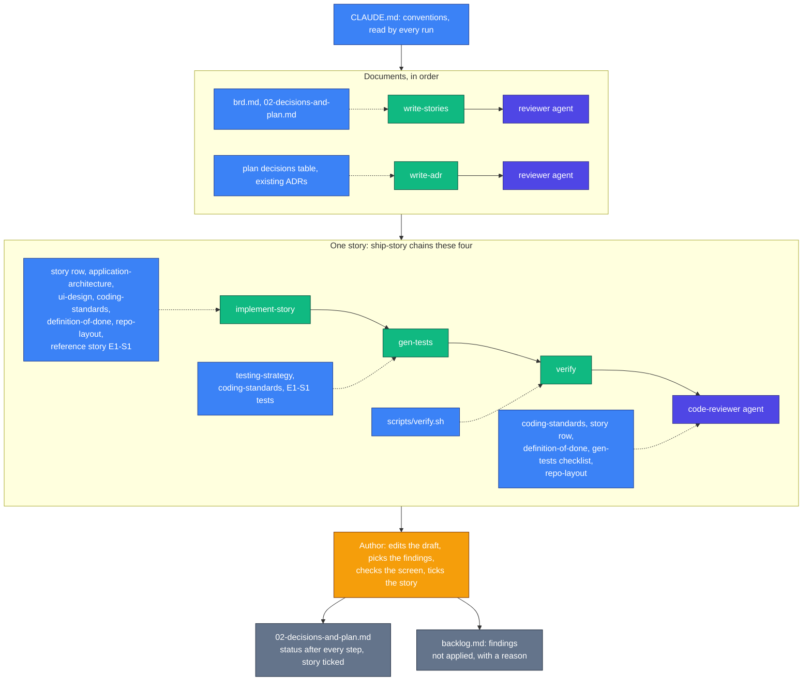

# AI tooling map - what runs at each step, and what it reads

One page. The tooling is six skills and two agents under `.claude/`, all plain Markdown, plus the root `CLAUDE.md` that every run reads first. Green is a skill (a checklist that runs inside the session), indigo is an agent (a separate read-only process that gives a second opinion), blue is a guideline document they read, grey is a record the author's step updates. The author sits between every pair of green boxes: nothing moves to the next step without a decision.

## One row per skill and agent

| Name | Kind | Runs when | How to run | Reads | Produces |
|------|------|-----------|------------|-------|----------|
| `write-stories` | skill | once, after the BRD | `/write-stories` | `brd.md`, the epic list in the plan | `epics-and-stories.md` in a fixed table format |
| `write-adr` | skill | one decision at a time | `/write-adr <decision>` | the plan's decisions table, existing ADRs | one ADR under `docs/03-architecture/adr/` |
| `reviewer` | agent, read-only | after any document draft | "Use the reviewer agent to review `<file>`" | `CLAUDE.md` and the document the draft must satisfy (brief, BRD, stories) | a short list of findings; never edits |
| `implement-story` | skill | start of a story | `/implement-story E2-S1` | story row, `application-architecture.md`, `ui-design.md`, `coding-standards.md`, `definition-of-done.md`, `03-repo-layout.md`, the E1-S1 files as the shape to copy | the vertical slice: changeset, entity, service, API, UI |
| `gen-tests` | skill | inside implement-story, and on request | `/gen-tests <file or story>` | `testing-strategy.md`, `coding-standards.md`, the E1-S1 tests | tests with the edge-case checklist applied |
| `verify` | skill | after every code change | `/verify`, or `make verify` in a terminal | `scripts/verify.sh` via `make verify` | PASS/FAIL per check; never marks a story done on FAIL |
| `code-reviewer` | agent, read-only | after the author has reviewed the diff | "Use the code-reviewer agent to review story E2-S1" | `CLAUDE.md`, `coding-standards.md`, story row, `definition-of-done.md`, the gen-tests checklist, `03-repo-layout.md`; runs `make verify` | APPROVE or REVISE with numbered findings |
| `ship-story` | skill | the default way to deliver a story | `/ship-story E2-S1`, then answer `apply`, `apply 1,3` or `skip` and `ok` | the four skills and the agent above, in order | the walkthrough card, then the story tick and plan status |

Skills are typed as slash commands in Claude Code; agents are asked for in plain words and Claude Code launches them. Both are picked up from `.claude/` automatically; if a new one does not appear, restart Claude Code.

## Which guideline is enforced where

| Document | Read by | Checked by |
|----------|---------|------------|
| `coding-standards.md` | implement-story, gen-tests | code-reviewer (conventions) |
| `definition-of-done.md` | implement-story | code-reviewer, whose six review points mirror its sections |
| `testing-strategy.md` | gen-tests | code-reviewer (edge-case coverage) |
| `03-repo-layout.md` | implement-story | code-reviewer (names, packages, paths) |
| `application-architecture.md`, `ui-design.md` | implement-story | reviewer, when the documents themselves change |
| `scripts/verify.sh` | verify, code-reviewer | itself: 50 checks, `VERIFY: ALL PASSED` or the first failure |

One honest shortcut: the definition of done is a template. Nobody ticks its checkboxes per story; the story tick, the code-reviewer verdict and the AI usage row stand in for them. For a project of this size that is enough, and it is said here so it is not mistaken for an oversight.
